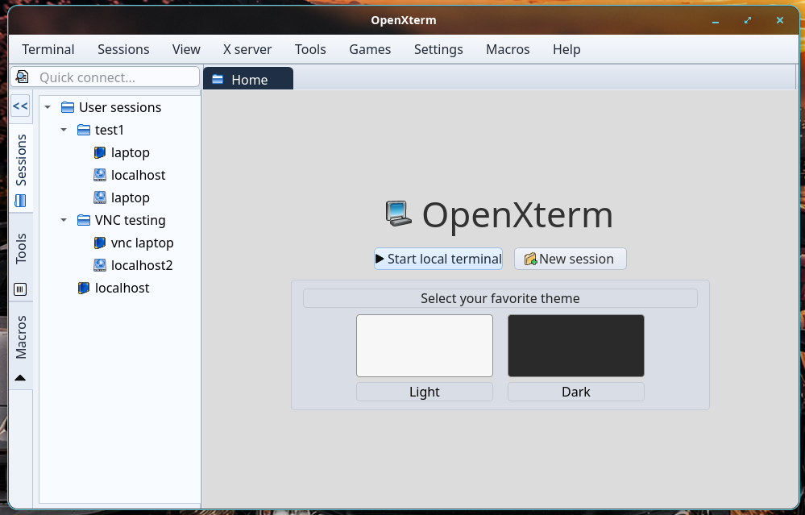

# OpenXterm

An open-source, lightweight alternative to MobaXterm for Linux, focused on essential remote session management (SSH & VNC).



## Current status
- Widgets-based shell scaffold implemented
- MobaXterm-style layout zones in place (menu, toolbar, quick connect, session tree, tab workspace, status and function key bar)
- Protocol scope for v1: SSH and VNC

## Build
```bash
cmake -S . -B build
cmake --build build -j
./build/OpenXterm
```
